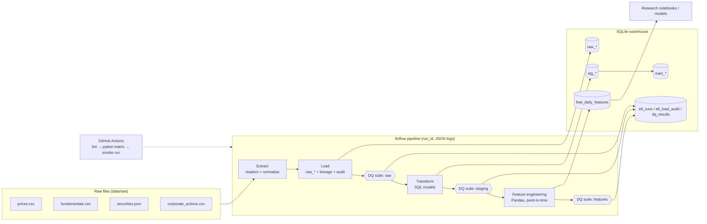

# FinFlow

A Python **ELT research pipeline** for structured financial datasets. FinFlow ingests raw
price, fundamentals, security-master and corporate-action files, lands them untouched in a SQL
warehouse, transforms them with SQL models and Pandas, validates every layer with automated
data quality checks, and produces a point-in-time feature table for quantitative research.
All runs emit structured JSON logs, and GitHub Actions CI lints, tests and smoke-runs the
full pipeline on every push.

## Features

- **Extract & load**: CSV / JSON / Parquet readers with column normalisation. Raw tables get
  lineage columns (`_run_id`, `_source_file`, `_ingested_at`), every load is recorded in
  `etl_load_audit`, and a source is skipped on re-runs if its SHA-256 checksum hasn't changed.
- **SQL transforms**: ordered `.sql` models in `finflow/sql/`
  - `stg_*`: typing, deduplication, rejection of impossible bars (kept in `stg_prices_rejected`)
  - `mart_daily_prices`: split-adjusted OHLCV with dividends and sector
  - `mart_fundamentals`: TTM aggregates, margins, leverage, ROE, YoY growth
- **Feature engineering** (Pandas) → `feat_daily_features`: multi-horizon returns, realised and
  Parkinson volatility, moving-average gaps, 12-1 style momentum, drawdown, volume z-score,
  ADV, Amihud illiquidity, valuation ratios (earnings yield, book-to-market, sales-to-price)
  joined **as of the report date** (no look-ahead), cross-sectional ranks, and a clearly named
  `target_fwd_ret_1d` research label.
- **Data quality**: declarative YAML suites (`config/checks.yaml`) with `not_null`, `unique`,
  `range`, `accepted_values`, `row_count`, `relationships`, `expression`, `custom_sql`,
  `freshness`, `null_ratio` and `zscore_outliers` checks. `error` failures stop the
  pipeline; `warn` failures are logged. All results go to `dq_results`.
- **Structured logging**: one JSON object per line with `run_id` and `step` attached, and
  step durations and metrics.
- **Synthetic data generator**: deterministic, offline data (with optional injected defects),
  so you don't need any API keys or credentials.

## Architecture



## Project layout

```
finflow/
  config.py          YAML config + FINFLOW_* env overrides
  logging_utils.py   JSON formatter, run context, step timing
  sample_data.py     synthetic dataset generator
  warehouse.py       SQLite wrapper
  extract.py         source readers
  load.py            raw loader, audit + run tables
  transform.py       SQL model runner (registers ff_ln / ff_exp)
  sql/               staging (0x_) and mart (1x_) models
  features.py        Pandas feature engineering
  quality/           check implementations + YAML suite runner
  pipeline.py        orchestrator
  cli.py             `finflow` command
config/
  pipeline.yaml      sources, paths, feature windows
  checks.yaml        data quality suites
tests/               pytest suite
.github/workflows/   CI
```

## How to run

Requires Python 3.10+.

```bash
python -m venv .venv && source .venv/bin/activate
pip install -e ".[dev]"

# 1. Generate sample data into data/raw (add --with-defects to see DQ warnings)
finflow generate

# 2. Run the full pipeline: extract → load → checks → transform → checks → features → checks
finflow run

# Inspect the warehouse
finflow tables
sqlite3 data/warehouse.db "SELECT * FROM dq_results ORDER BY checked_at DESC LIMIT 20;"
```

Individual steps:

```bash
finflow extract [--force]          # extract + load raw tables
finflow check raw [--no-fail]      # run a DQ suite: raw | staging | features
finflow transform [--select prices] # run all or selected SQL models
finflow features                   # rebuild feat_daily_features
finflow run --skip-checks          # full run without DQ gates
```

Configuration lives in `config/pipeline.yaml`; any scalar setting can be overridden with an
environment variable (see `.env.example`), e.g. `FINFLOW_WAREHOUSE_PATH`,
`FINFLOW_LOG_FILE=logs/finflow.jsonl`, `FINFLOW_FAIL_ON_ERROR=false`.

To use your own data, put files in `data/raw` with the same columns as the generated ones
(or edit `sources:` in `pipeline.yaml`).

Exit codes: `0` success, `1` extract failure, `2` a blocking data quality check failed.

## How to test

```bash
pip install -e ".[dev]"
ruff check .
pytest                       # unit + end-to-end tests
pytest --cov=finflow         # with coverage
```

The suite covers extraction and checksum-based skip logic, staging dedup/rejection, split
adjustment, TTM fundamentals, feature maths and the point-in-time join, every check type, suite
severity handling, and end-to-end runs (clean data, dirty data, failed run, CLI).

CI (`.github/workflows/ci.yml`) runs ruff, pytest on Python 3.10–3.12, and a smoke run of
the whole pipeline on generated dirty data, uploading the JSON logs and warehouse as
artifacts.
